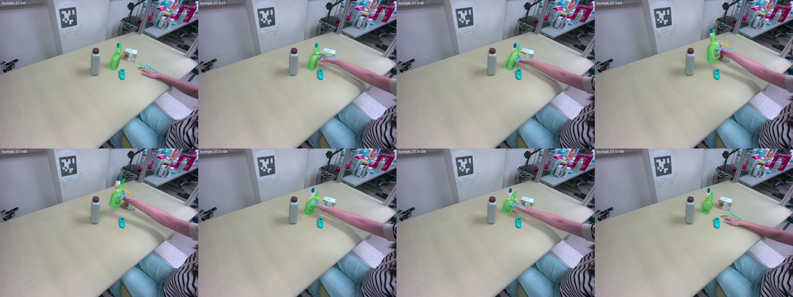

# DATA302 Final Project — Hand-Object Interaction Reconstruction from Monocular RGB Video

> **DRAFT** (2026-11-07). Items marked **[TBD]** will be fixed before release.

> [!IMPORTANT]
> **Read before you start**
> 1. **Read this whole README carefully before you start.** It is the only specification of the
>    task, the rules and the output format, and it will be updated (watch this repository).
> 2. **Follow the output format (§6) exactly.** A file that breaks the format is rejected. A file
>    that uses a different convention (units, camera frame, rotation layout, MANO settings, mesh
>    centring) is still read, but as a *different* hand or object, and is scored that way: correct
>    work in a wrong format gets a wrong score. Check every item of §6 and run the self-checks in §6.8.
> 3. **Questions**: email the TAs at the addresses announced on the final project slides.

Design your own pipeline that takes a **monocular RGB video** (fixed camera, one right hand, one object)
and reconstructs

* the **MANO hand trajectory**,
* the **object mesh** (real size), and
* the **object 6D pose trajectory**,

all in the **camera frame** of the video.

**Deadline: 2026-12-07** 

**Contents**: [1 Layout](#1-repository-layout) · [2 Environment](#2-environment) ·
[3 MANO](#3-mano) · [4 Data](#4-data) · [5 Pipeline rules](#5-your-pipeline) ·
[6 Output format](#6-output-format) · [7 Leaderboard](#7-leaderboard-provisional) ·
[8 Submission](#8-submission) · [9 Grading](#9-grading-draft)

---

## 1. Repository layout

Fork or copy this repository and keep this structure. Your code submission is this folder.

```
DATA302_Final_Project/
├── README.md          # this file (rules + exact output format)
├── examples/          # a real example clip + a valid output for it + its overlay video (§6.8)
├── tools/overlay.py   # draws your results on the input video -> overlay video (§6.8)
├── submodules/        # external models you use (git submodules)
├── mano_models/       # MANO_RIGHT.pkl goes here (NOT included, §3)
├── main/              # YOUR pipeline code
├── data/videos/       # the input videos <video_id>.mp4 (§4) — not committed
└── results/           # your outputs: <video_id>.json + <video_id>.glb (§6) — not committed
```

## 2. Environment

Set up your own environment(s): the models you combine are your choice and have their own
requirements. Only the output format needs two things in addition:

* `smplx` to run the MANO forward pass, which needs the GitHub version of `chumpy` to read the
  official `.pkl`: `pip install smplx git+https://github.com/mattloper/chumpy`
  (`chumpy` 0.70 from PyPI fails to import with numpy ≥ 1.24).
* `trimesh` to write the `.glb` mesh.
* For the overlay tool (§6.8): `pip install numpy trimesh pillow imageio imageio-ffmpeg`
  (`imageio-ffmpeg` installs its own ffmpeg binary).

## 3. MANO

The MANO model files may **not** be redistributed, so every student downloads them once:

1. Register at <https://mano.is.tue.mpg.de> and download **Models & Code**.
2. Copy `MANO_RIGHT.pkl` into `mano_models/` → `mano_models/MANO_RIGHT.pkl`.
3. Never commit it (`.gitignore` already excludes `*.pkl` in that folder).

The course uses **exactly** these settings; they change the meaning of the pose numbers:

```python
import smplx
mano = smplx.MANO("mano_models", is_rhand=True, use_pca=False, flat_hand_mean=True)
```

Check your setup with the example file (§6.8).

## 4. Data

Videos: **[TBD: download link]**. Put them **exactly** here (paths in this README and in
`tools/overlay.py` assume this layout, relative to the repository root):

```
data/videos/
├── easy_01.mp4    easy_02.mp4
├── normal_01.mp4  normal_02.mp4
├── hard_01.mp4    hard_02.mp4
├── videos.json        # {"easy_01": {"num_frames": F, "fps": 30, "width": W, "height": H}, ...}
└── ATTRIBUTION.txt    # sources and licenses of the clips [TBD]
```

* Frame `t` is the `t`-th frame (0-based) decoded from `<video_id>.mp4`; `F` is `num_frames` in
  `videos.json`. Your results must have exactly `F` frames.
* All videos show a **right hand**. **No camera intrinsics are given**: estimate them yourself
  (e.g. MoGe-3), for the `width` × `height` of the video.
* The clips come from public datasets; do not redistribute them outside this course.

## 5. Your pipeline

* Put your code in `main/` and the external models you use in `submodules/` (see the READMEs there).
* **One pipeline and one configuration for all videos**: no per-video code or parameters.
* Your code must regenerate your submitted results from `data/` (the TAs re-run a sample).

**Allowed**: manual point prompts for SAM3 (no need to automate target detection; SAM3's video
propagation is useful). Manually choosing the best frame for SAM3D.
**Not allowed**: any other manual intervention, e.g. manually adjusting the object scale; any
ground truth or annotation of the test videos from any source.
**AI tools**: allowed for writing code only, not for producing masks, 3D estimates, etc.
[TBD: wording aligned with the course slides]

---

## 6. Output format

### 6.1 Files

For **every video**, two files in `results/`:

```
results/
├── easy_01.json     # MANO parameters + MANO forward outputs + object pose + intrinsics
├── easy_01.glb      # final object mesh (real size, centroid at the origin)
├── easy_02.json
├── easy_02.glb
└── …                # 6 videos → 12 files
```

### 6.2 Conventions

| Item | Convention |
|---|---|
| Camera frame | **OpenCV**: +x right, +y down, +z forward (into the scene). The camera is static; there is no world frame |
| Length unit | **metres** (vertices, joints, translations) |
| Intrinsics | **pixels**, for the resolution of the video (`width` × `height` in `videos.json`) |
| Frames | `F = num_frames` of the video (`data/videos/videos.json`). Entry `t` corresponds to frame `t` (0-based) of `data/videos/<video_id>.mp4`. **Every** frame is filled (JSON has no NaN: interpolate frames where your method failed) |
| Hand | right hand, `MANO_RIGHT.pkl`, `use_pca=False`, `flat_hand_mean=True` (§6.4) |
| Object rotation | 6D representation, **row** layout (§6.5) |
| Object mesh | `.glb`, real size, **centroid at the origin** (§6.6) |
| Object pose | object → camera: `X_cam = R @ v + t` for every vertex `v` of the `.glb` |
| Numbers | plain JSON numbers, rounded to 5 decimals (0.01 mm) |

### 6.3 JSON keys

The structure below is annotated for reading (`//` comments and `…` are not part of the file).
`examples/results/example_01.json` is a complete, valid file.

```text
{
  "format_version": "1.0",
  "video_id":   "easy_01",
  "num_frames": F,
  "intrinsics": [[fx, 0, cx], [0, fy, cy], [0, 0, 1]],  // [3,3] your estimate, pixels
  "mano": {
    "pose":     [[… 48 …], …],          // [F,48] axis-angle (radians): global_orient (3) + 15 finger joints (45)
    "transl":   [[x, y, z], …],         // [F,3]  metres, the `transl` argument of smplx.MANO
    "betas":    [… 10 …],               // [10]   one hand shape for the whole video
    "vertices": [[[x, y, z] × 778], …], // [F,778,3] smplx.MANO output.vertices, camera frame, metres
    "joints":   [[[x, y, z] × 16], …]   // [F,16,3]  smplx.MANO output.joints,   camera frame, metres
  },
  "object": {
    "mesh":   "easy_01.glb",            // file name of the mesh next to this JSON
    "rot6d":  [[… 6 …], …],             // [F,6] first two ROWS of R (object -> camera)
    "transl": [[x, y, z], …]            // [F,3] metres, position of the mesh origin = mesh centroid
  }
}
```

### 6.4 Hand: MANO parameters and forward outputs

`vertices` and `joints` must be **exactly** the output of this forward pass with your `pose`,
`betas`, `transl` (the TAs re-run it to check):

```python
import smplx, torch
mano = smplx.MANO("mano_models", is_rhand=True, use_pca=False, flat_hand_mean=True)
pose   = torch.as_tensor(pose,   dtype=torch.float32)          # (F, 48)
betas  = torch.as_tensor(betas,  dtype=torch.float32)          # (10,)
transl = torch.as_tensor(transl, dtype=torch.float32)          # (F, 3)
out = mano(global_orient=pose[:, :3], hand_pose=pose[:, 3:],
           betas=betas[None].expand(len(pose), -1), transl=transl)
vertices = out.vertices.detach().numpy()   # (F, 778, 3)
joints   = out.joints.detach().numpy()     # (F, 16, 3)
```

* **`flat_hand_mean=True`**: `hand_pose = 0` is the flat open hand. With `False` (smplx's default)
  the MANO mean pose (about 33° per finger joint) is added to your numbers, and the same 48
  numbers give another hand (on the example clip of §6.8 the fingertips move by about 6 cm).
  Convert if your model uses the other setting.
* **`transl`** is added to all vertices after the hand is rotated about its wrist joint (smplx). It
  is **not** the wrist position (the wrist is about 9.6 cm from the MANO origin).
* **`pose`** is axis-angle. The 15 finger rotations are relative to their parent joint. If your
  model gives rotation matrices (e.g. HaPTIC, `(F, 16, 3, 3)`), convert them, e.g.
  `scipy.spatial.transform.Rotation.from_matrix(R.reshape(-1, 3, 3)).as_rotvec().reshape(F, 48)`.
* **`betas`**: one vector for the video. If your model predicts a shape per frame, pick or
  average one and use it in the forward pass.

### 6.5 Object rotation: 6D representation, row layout

The 6 numbers are the **first two rows** of the rotation matrix `R` (object → camera), as in
PyTorch3D `matrix_to_rotation_6d` / `rotation_6d_to_matrix`:

```python
import numpy as np
rot6d = R[:, :2, :].reshape(F, 6)                      # R: (F, 3, 3)

# back to R (this is what the grader does)
a1, a2 = rot6d[:, :3], rot6d[:, 3:]
b1 = a1 / np.linalg.norm(a1, axis=1, keepdims=True)
b2 = a2 - (b1 * a2).sum(1, keepdims=True) * b1
b2 /= np.linalg.norm(b2, axis=1, keepdims=True)
R = np.stack([b1, b2, np.cross(b1, b2)], axis=1)        # rows b1, b2, b3
```

Using the first two **columns** instead gives the transposed (inverse) rotation and a wrong object
pose, without any error message.

### 6.6 Object mesh and translation: centroid at the origin

* `<video_id>.glb` is the **final** object mesh, real size (any scale already applied), a single
  triangle mesh without node transforms.
* It is saved **translated so that its centroid is at the origin**:
  `trimesh.load(path, force="mesh").centroid` must be `(0, 0, 0)` within 1 mm.
* The pose applies directly to the saved vertices: `X_cam = R @ v + t`. Because the mesh is
  centred, `t` is the position of the object centroid in the camera frame.

If your poses refer to an uncentred mesh (e.g. FoundationPose `ob_in_cam`), centre the mesh and
move every translation by `R @ c`, so that the object stays where it is in the camera:

```python
import numpy as np, trimesh
mesh = trimesh.load("my_object.glb", force="mesh")   # the mesh your poses R (F,3,3), t (F,3) refer to
c = mesh.centroid                                     # area-weighted surface centroid, object frame
mesh.vertices -= c                                    # centroid -> origin
t = t + np.einsum("fij,j->fi", R, c)                  # R (v - c) + t_new = R v + t, for every frame
mesh.export(f"results/{video_id}.glb")                # export with trimesh (no axis conversion)

# check: the saved mesh is centred (tolerance 1 mm)
assert np.abs(trimesh.load(f"results/{video_id}.glb", force="mesh").centroid).max() < 1e-3
```

Export the `.glb` with `trimesh`. Tools such as Blender convert axes (Z-up / Y-up) or add node
transforms on export, which moves the vertices out of the frame that `R`, `t` refer to.

### 6.7 Writing the JSON

```python
import json, numpy as np
r = lambda a: np.round(np.asarray(a, dtype=np.float64), 5).tolist()
sub = {
    "format_version": "1.0", "video_id": video_id, "num_frames": F,
    "intrinsics": r(K),
    "mano": {"pose": r(pose), "transl": r(transl), "betas": r(betas),
             "vertices": r(vertices), "joints": r(joints)},
    "object": {"mesh": f"{video_id}.glb", "rot6d": r(rot6d), "transl": r(t)},
}
with open(f"results/{video_id}.json", "w") as f:
    json.dump(sub, f, separators=(",", ":"), allow_nan=False)   # fails if anything is NaN
```

A 300-frame video gives a JSON file of about 6 MB.

### 6.8 Example files and self-checks

`examples/` holds a short clip from a public dataset (not one of the course videos; source and
license in `examples/ATTRIBUTION.md`) and a complete, valid output for it:

```
examples/
├── videos/example_01.mp4         # input: 150 frames, 640 × 480, 30 fps (+ videos.json)
├── results/example_01.json       # output in the format of this section
├── results/example_01.glb        # object mesh, centred at its centroid
└── overlays/example_01.mp4/.jpg  # tools/overlay.py drawing of the output on the input
```

The output was made from the dataset's annotations **with errors added on purpose** (hand pose and
depth, object size, rotation and depth, focal length), so it is close to, but visibly not on, the hand
and the object. It shows the file format, not the accuracy you should reach. Everything in it is
consistent: `vertices` and `joints` are the MANO forward output of its `pose`, `betas`, `transl` with
the course settings, and the mesh is centred at its centroid. Use it to check your setup:

```python
import json, numpy as np, torch, smplx, trimesh
ex = json.load(open("examples/results/example_01.json"))

# 1) MANO settings: your forward pass must reproduce the example vertices
mano = smplx.MANO("mano_models", is_rhand=True, use_pca=False, flat_hand_mean=True)
pose = torch.tensor(ex["mano"]["pose"], dtype=torch.float32)
out = mano(global_orient=pose[:, :3], hand_pose=pose[:, 3:],
           betas=torch.tensor(ex["mano"]["betas"], dtype=torch.float32)[None].expand(len(pose), -1),
           transl=torch.tensor(ex["mano"]["transl"], dtype=torch.float32))
print(np.abs(out.vertices.detach().numpy() - np.array(ex["mano"]["vertices"])).max())   # < 1e-4

# 2) mesh centred at its centroid
print(trimesh.load("examples/results/example_01.glb", force="mesh").centroid)           # ~ (0, 0, 0)
```

3) **Rotation layout**: decoding `ex["object"]["rot6d"][0]` with the code in §6.5 must give
(reading the 6 numbers as columns instead would give the transpose)

```
R_0 = [[ 0.6139, -0.1837, -0.7677],
       [-0.3414,  0.8151, -0.4680],
       [ 0.7118,  0.5494,  0.4376]]
```

4) **Overlay tool on the example**: this must reproduce `examples/overlays/example_01.mp4`:

```bash
python tools/overlay.py --video examples/videos/example_01.mp4 --json examples/results/example_01.json \
                        --out overlays/example_01.mp4 --side-by-side --grid
```



5) **On your own videos**: draw your results on the input video with the provided tool. It reads
your files exactly as the grader does (rotation layout, centred mesh, your intrinsics), so what you
see is what is graded. Install `pip install numpy trimesh pillow imageio imageio-ffmpeg`, then from
the repository root:

```bash
python tools/overlay.py --video_id easy_01        # one video, default paths (below)
python tools/overlay.py --all                     # every results/*.json
python tools/overlay.py --video data/videos/easy_01.mp4 --json results/easy_01.json \
                        --glb results/easy_01.glb --out overlays/easy_01.mp4   # explicit paths
```

| Argument | Default |
|---|---|
| `--video` | `data/videos/<video_id>.mp4` |
| `--json` | `results/<video_id>.json` |
| `--glb` | the `object.mesh` file next to the JSON (`results/<video_id>.glb`) |
| `--out` | `overlays/<video_id>.mp4` |
| `--side-by-side` | off: input and overlay next to each other |
| `--grid` | off: also save an 8-frame overview `overlays/<video_id>.jpg` |

The output is an mp4 with the same frames and fps as the input. The object is drawn as a shaded,
semi-transparent green mesh, the hand as cyan vertices plus a 21-joint skeleton (one colour per
finger); both must lie on the object and the hand in the video. The tool stops with an error if the
video and your JSON do not have the same number of frames.

If they do not line up, a convention above is wrong (camera frame, units, rotation layout, mesh
centring, MANO settings).

---

## 7. Leaderboard (provisional)

> Provisional: the details of this section are still being decided [TBD].

* **Where**: Gradescope, assignment "Final Project Leaderboard" [TBD: course link / entry code].
* **What to upload**: all 12 result files, either
  * as **one zip** (`results.zip`, the files at the top level of the zip, no sub-folders; upload the
    zip itself), or
  * as **individual files**, selecting all `.json` and `.glb` files together in one upload.

  File names must be **exactly** `<video_id>.json` and `<video_id>.glb`, e.g. `easy_01.json` +
  `easy_01.glb`, …, `hard_02.json` + `hard_02.glb` (lower case, as the video files in `data/videos/`).
  Every `.json` needs its `.glb` with the same name in the same upload. A missing or misnamed file
  means that video is missing.
* **How often**: no limit on the number of uploads. Each upload is graded automatically within a
  few minutes.
* **What you see after an upload**:
  * a format check for each video: `OK`, or the reason it was rejected (missing file, wrong shape,
    NaN, values that are not plausible in metres, mesh not centred, …);
  * your scores for each video and your overall score.
* **What the leaderboard shows**: the scores of everyone's latest upload under a pseudonym you
  choose at upload time, sortable by each column [TBD: columns].
* **Missing or rejected videos** get the lowest possible score for that video [TBD].
* **Scores on the leaderboard are feedback**: they are computed on a part of the frames and compared
  with the class at the time of the last update [TBD]. The final grade is computed after the
  deadline on all frames from your LMS submission (§8).
* Do not try to probe or reverse-engineer the ground truth through the leaderboard.

## 8. Submission

```bash
cd results && zip ../results.zip *.json *.glb
```

| Where | What |
|---|---|
| **Gradescope** (leaderboard) | `results.zip` — any number of uploads [TBD: link] |
| **LMS** (final, by the deadline) | report (PDF), code (this folder, without `data/`, `mano_models/*.pkl`, checkpoints), and the **same** `results.zip` |

The leaderboard is feedback (§7). The final grade is computed after the deadline from the LMS submission.

## 9. Grading (draft)

* Quantitative benchmark scores of your results, per video, weighted by difficulty:
  object trajectory error, hand trajectory error, contact error [TBD: final metric list].
  Before scoring, translations are aligned to the ground truth using the object **centroid**.
* Design and analysis of your post-optimization.
* Report clarity and code quality.
