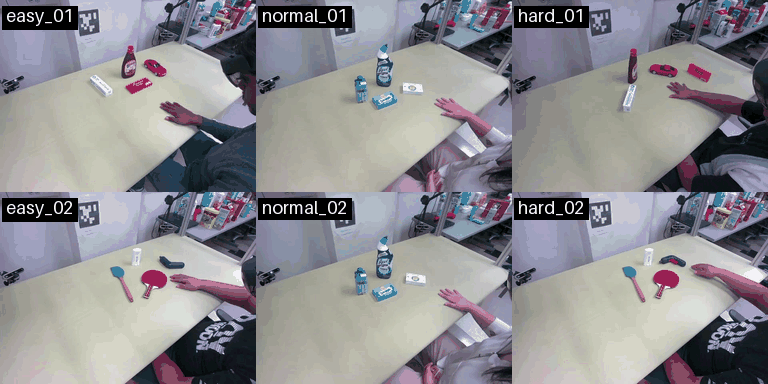
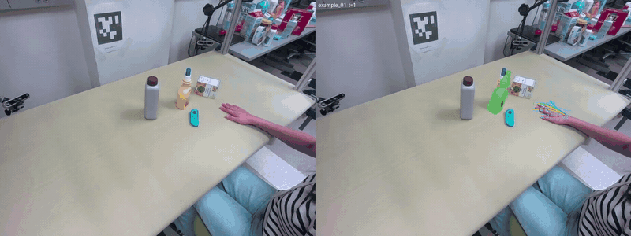
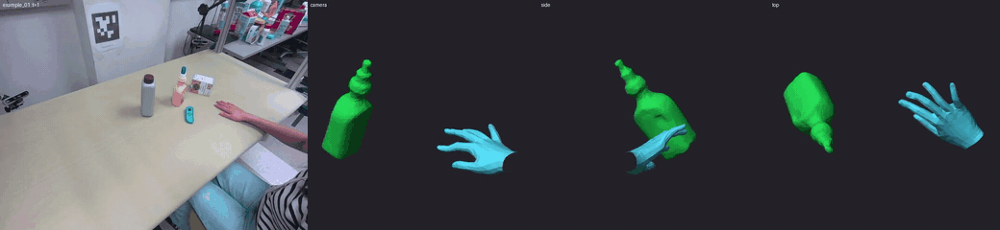

<h1 align="center">Final Project : Hand-Object Interaction Reconstruction only from Monocular RGB Video (DATA302 2026)</h1>


> [!IMPORTANT]
> 1. **Read this README carefully YOURSELF before you start final project.** 
> 2. **Follow the output format ([§5](#5-final-output-format)) exactly.** A file that breaks the format is rejected.

> [!IMPORTANT]
> **🔔 Updates (Nov 16)**
> - **`normal_02` and `hard_02` were exchanged.** Download the two videos again or swap their names ([§3](#3-input-videos)).
> - New requirements for the GLB file, for example at most 10,000 faces ([§5.2](#52-glb-file-object-mesh)).
> - New tool `tools/mesh_view.py` to check your meshes ([§5.3](#53-example-files-and-self-checks)).
> - The leaderboard is now open ([§6](#6-leaderboard)).

Design your own pipeline that takes a **monocular RGB video** (fixed camera) and reconstructs
* the **MANO hand trajectory**,
* the **object mesh** (real size), and
* the **object 6D pose trajectory**.

**Contents**

- [1. Repository layout](#1-repository-layout)
- [2. MANO](#2-mano)
- [3. Input videos](#3-input-videos)
- [4. Implementation](#4-your-pipeline)
- [5. Final output format](#5-final-output-format)
- [6. Leaderboard](#6-leaderboard)
- [7. Submission](#7-submission)

---

## 1. Repository layout

Fork or clone this repository to start your final project.

```
DATA302_Final_Project/
├── README.md          # 
├── examples/          # an example clip, a valid output for it, and its overlay (§5.3)
├── tools/overlay.py   # draws a result on its input frames -> overlay video (§5.3)
├── tools/mesh_view.py # renders the hand and object meshes from 3 views -> video (§5.3)
├── submodules/        # external models you use (git submodules)
├── mano_models/       # see §2
├── main/              # implement your pipeline here
├── data/              # see §3
└── results/           # your outputs: <video_id>.json + <video_id>.glb (§5) 
```

## 2. MANO

1. Register at <https://mano.is.tue.mpg.de> and download **Models & Code**.
2. Copy `MANO_RIGHT.pkl` into `mano_models/` → `mano_models/MANO_RIGHT.pkl`.
3. Never commit it (`.gitignore` already excludes `*.pkl` in that folder).

The course uses **exactly** these settings; they change the meaning of the pose numbers:

```python
import smplx
mano = smplx.MANO("mano_models", is_rhand=True, use_pca=False, flat_hand_mean=True)
```

## 3. Input videos

Download videos here: **<[LINK](https://drive.google.com/drive/folders/12O_mhWdEN5_P0Z08AX5L36V1zzegcjZ3?usp=drive_link)>**. Put them under `data/` and extract like below:

```
data/<video_id>/
└── frames/000000.jpg, 000001.jpg, …   # file number = frame index t
```
**🔔 Update (Nov 16)**

> [!WARNING]
> **`normal_02` and `hard_02` were exchanged.** The video that was `normal_02` is now `hard_02`,
> and the video that was `hard_02` is now `normal_02`. Download the two videos again from the link
> above, or swap the names of your local copies (videos, extracted frames and results). Your results must use the new ids. A result with the old
> numbering is rejected by the format check (wrong `num_frames`).

All videos are 30 fps.

| Video id | Frames |
|---|---|
| `easy_01` | 131 |
| `easy_02` | 451 |
| `normal_01` | 321 |
| `normal_02` | 331 |
| `hard_01` | 601 |
| `hard_02` | 481 |



`extreme_01` and `extreme_02` are **not graded**. Including them in your report is optional.

## 4. Your HOI reconstruction pipeline

* **Only** put your implemented pipeline code in `main/` (no debugging logs or visualizations).
* **One pipeline and one configuration for all videos**: no per-video code or parameters.
* Your code must regenerate your submitted results from `data/` (the TAs re-run a sample).

#### 🙆 Allowed

- **Manual prompts:** point prompts for SAM3; target detection does not need to be automated.
- **Frame selection:** manually choosing the best frame for SAM3D.
- **External models:** open-source, off-the-shelf models.

#### 🙅 Not allowed

- **Other manual intervention:** e.g. manually adjusting the object scale.
- **Cheating.**
- **External models:** commercial external models.

👾 **Frontier LLMs** (GPT, Claude, etc.) are allowed for coding only — not for generating masks, 3D object estimates, or any other results.


## 5. Final output format

> **Follow the output format below carefully when preparing your leaderboard submission.**

### Result files

Save **two files for every video** in `results/`:

1. A **JSON** file containing the hand and object trajectories. ([§5.1](#51-json-file-hand-and-object-trajectory))
2. A **GLB** file containing the object mesh. ([§5.2](#52-glb-file-object-mesh))

Use the **video ID as the filename** (e.g. `easy_01.json` and `easy_01.glb`).

```
results/
├── easy_01.json     # MANO parameters + MANO forward outputs + object pose + intrinsics
├── easy_01.glb      # final object mesh (real size, centroid at the origin)
├── easy_02.json
├── easy_02.glb
└── …                # 6 videos → 12 files
```

### Conventions overview

| Item | Convention |
|---|---|
| Camera frame | **OpenCV**: +x right, +y down, +z forward (into the scene). Express all trajectories in this fixed camera frame |
| Length unit | **meters** (vertices, joints, translations) |
| Intrinsics | **pixels**, at the resolution of the input frames |
| Frames | `F` is the total number of frames. Entry `t` corresponds to `frames/{t:06d}.jpg`. Provide results for **every frame**; interpolate missing estimates. All values must be finite (no NaN or Infinity) |
| Hand | right hand, `MANO_RIGHT.pkl`, `use_pca=False`, `flat_hand_mean=True` (§5.1) |
| Object rotation | 6D representation, **row** layout (§5.1) |
| Object mesh | `.glb`, scale applied (real size), **centroid at the origin** (§5.2) |
| Object pose | object → camera: `X_cam = R @ v + t` for every vertex `v` of the `.glb` |

### 5.1 JSON file (Hand and Object trajectory)

Save the final reconstructed hand and object trajectories and estimated intrinsics as **`<video_id>.json`**.

Specifically, each JSON file must contain:

- The **camera intrinsics**.
- **MANO parameters and forward outputs**.
- **Object poses** for all `F` frames.

The `object.mesh` field names the corresponding GLB file in the **same directory**.

**JSON structure**

The schema below includes comments and placeholders for clarity; omit them from your JSON.
See [`examples/results/example_01.json`](examples/results/example_01.json) for a complete example.

```text
{
  "format_version": "1.0",
  "video_id":   "easy_01",
  "num_frames": F,
  "intrinsics": [[fx, 0, cx], [0, fy, cy], [0, 0, 1]],  // [3,3] your estimate, pixels
  "mano": {
    "pose":     [[… 48 …], …],          // [F,48] axis-angle (radians): global_orient (3) + 15 finger joints (45)
    "transl":   [[x, y, z], …],         // [F,3]  meters, the `transl` argument of smplx.MANO
    "betas":    [… 10 …],               // [10]   one hand shape for the whole video
    "vertices": [[[x, y, z] × 778], …], // [F,778,3] smplx.MANO output.vertices, camera frame, meters
    "joints":   [[[x, y, z] × 16], …]   // [F,16,3]  smplx.MANO output.joints,   camera frame, meters
  },
  "object": {
    "mesh":   "easy_01.glb",            // file name of the mesh next to this JSON
    "rot6d":  [[… 6 …], …],             // [F,6] first two ROWS of R (object -> camera)
    "transl": [[x, y, z], …]            // [F,3] meters, position of the mesh origin = mesh centroid
  }
}
```

#### 5.1.1 Hand trajectory

Compute `vertices` and `joints` of MANO hand mesh from the `pose`, `betas`, and `transl` using the MANO
forward pass below.

The TAs will repeat this computation to verify that your parameters and outputs agree,
allowing for rounding when saving the JSON.

```python
import smplx, torch
mano = smplx.MANO("mano_models", is_rhand=True, use_pca=False, flat_hand_mean=True)
pose   = torch.as_tensor(pose,   dtype=torch.float32)          # (F, 48)
betas  = torch.as_tensor(betas,  dtype=torch.float32)          # (10,)
transl = torch.as_tensor(transl, dtype=torch.float32)          # (F, 3)
out = mano(global_orient=pose[:, :3], hand_pose=pose[:, 3:],
           betas=betas[None].expand(len(pose), -1), transl=transl)
vertices = out.vertices.detach().numpy()   # (F, 778, 3)
joints   = out.joints.detach().numpy()     # (F, 16, 3)
```

**Parameter conventions**

* **Pose convention**: `pose` contains 48 axis-angle values in radians: 3 for the global
  orientation and 45 for the 15 finger joints. Each finger rotation is relative to its parent
  joint. If your model returns rotation matrices of shape `(F, 16, 3, 3)`, convert them with
  `scipy.spatial.transform.Rotation.from_matrix(R.reshape(-1, 3, 3)).as_rotvec().reshape(F, 48)`.

* **Hand mean**: use `flat_hand_mean=True`, so `hand_pose = 0` represents a flat, open hand.
  If your model uses `flat_hand_mean=False`, convert its pose parameters to this convention
  before running the forward pass.

* **Translation**: `transl` is the translation argument passed to `smplx.MANO`, in meters.
  It is applied after rotation about the wrist joint and is **not the wrist position**.

* **Hand shape**: use one `betas` vector for the entire video. If your model estimates a
  different shape for each frame, select or average those estimates and use the resulting
  vector for every frame.

#### 5.1.2 Object trajectory

**Rotation — `object.rot6d`**

`object.rot6d` stores the **first two rows** of the object-to-camera rotation matrix `R`,
following the convention used by PyTorch3D
`matrix_to_rotation_6d` / `rotation_6d_to_matrix`:

```python
import numpy as np
rot6d = R[:, :2, :].reshape(F, 6)                      # R: (F, 3, 3)

# back to R (this is what the grader does)
a1, a2 = rot6d[:, :3], rot6d[:, 3:]
b1 = a1 / np.linalg.norm(a1, axis=1, keepdims=True)
b2 = a2 - (b1 * a2).sum(1, keepdims=True) * b1
b2 /= np.linalg.norm(b2, axis=1, keepdims=True)
R = np.stack([b1, b2, np.cross(b1, b2)], axis=1)        # rows b1, b2, b3
```

> **Do not use the first two columns**: decoding them as rows produces the transposed (inverse)
> rotation.

**Translation — `object.transl`**

`object.transl` stores the position of the **object mesh centroid** (§5.2.1) in the camera frame, in meters.

Together, the rotation and translation map each saved mesh vertex to the camera frame:

```text
X_cam = R @ v + t
```

If you center the mesh before export, update the translations as shown
in §5.2.1 **before writing the JSON**.

#### 5.1.3 Writing the JSON

Convert arrays to **plain JSON lists** and round floating-point values to **five decimal places**.

In this example:

- `K` is the camera intrinsic matrix.
- `rot6d` contains the encoded object rotations.
- `t` contains the translations for the **centered mesh** (§5.2.1).

```python
import json, numpy as np
r = lambda a: np.round(np.asarray(a, dtype=np.float64), 5).tolist()
sub = {
    "format_version": "1.0", "video_id": video_id, "num_frames": F,
    "intrinsics": r(K),
    "mano": {"pose": r(pose), "transl": r(transl), "betas": r(betas),
             "vertices": r(vertices), "joints": r(joints)},
    "object": {"mesh": f"{video_id}.glb", "rot6d": r(rot6d), "transl": r(t)},
}
with open(f"results/{video_id}.json", "w") as f:
    json.dump(sub, f, separators=(",", ":"), allow_nan=False)   # fails if anything is NaN
```

> `allow_nan=False` raises an error if any value is **NaN or Infinity**. Resolve missing or invalid
> estimates before saving.

### 5.2 GLB file (Object mesh)

Save the final reconstructed object as **`<video_id>.glb`** with the following properties:

* **Single mesh**: export one triangle mesh without node transforms.

* **Real size**: apply the estimated or optimized scale to the vertices and use meters.

* **Centroid at the origin**: use the area-weighted surface centroid returned by
  `trimesh.load(path, force="mesh").centroid`. Each coordinate must be **within 1 mm of zero**.

**🔔 Update (Nov 16)**

* **At most 10,000 faces** (and 30,000 vertices). Decimate the mesh before export.

* **Self-contained file**: binary glTF 2.0 (`.glb`), at most 50 MB, all data embedded (no external textures or buffers).

* **Plausible size**: the bounding-box diagonal must be between 0.01 m and 1.0 m.

* **The object only**: the `.glb` must contain the mesh of the object and nothing else. Remove the hand, the table and any floating fragments, and make sure the surface is closed (no holes, no flipped faces). Look at your mesh with `tools/mesh_view.py` (§5.3, "Check the example mesh") before you upload.

#### 5.2.1 Centering the mesh and updating its trajectory

The JSON poses must refer to the vertices stored in the GLB.

If your estimated poses refer to an uncentered mesh:

1. Subtract its centroid `c` from the vertices.
2. Add `R @ c` to each translation.

This preserves the object's position in the camera frame:

```text
R @ (v - c) + (t + R @ c) = R @ v + t
```

Apply this correction **before saving `object.transl`** in the JSON ([§5.1](#51-json-file-hand-and-object-trajectory)):

```python
import numpy as np, trimesh
mesh = trimesh.load("my_object.glb", force="mesh")   # the mesh your poses R (F,3,3), t (F,3) refer to
c = mesh.centroid                                     # area-weighted surface centroid, object frame
mesh.vertices -= c                                    # centroid -> origin
t = t + np.einsum("fij,j->fi", R, c)                  # R (v - c) + t_new = R v + t, for every frame
mesh.export(f"results/{video_id}.glb")                # export with trimesh (no axis conversion)

# check: the saved mesh is centered (tolerance 1 mm)
assert np.abs(trimesh.load(f"results/{video_id}.glb", force="mesh").centroid).max() < 1e-3
```

> Export the GLB with **`trimesh`**, as above. Other exporters may convert axes or add node
> transforms; either change can make the saved mesh inconsistent with the JSON poses.

### 5.3 Example files and self-checks

`examples/` contains a short clip from a public dataset (not one of the course videos; source
and license in `examples/ATTRIBUTION.md`) and a complete, valid output for it:

```
examples/
├── data/example_01/frames/       # input: 000000.jpg … 000149.jpg (640 × 480), same layout as §3
├── results/example_01.json       # output in the format of §5.1
├── results/example_01.glb        # object mesh, centered at its centroid (§5.2)
├── overlays/example_01.mp4       # the output drawn on the input (tools/overlay.py)
└── mesh_views/example_01.mp4     # the output meshes from three views (tools/mesh_view.py)
```

(The `.gif` next to each `.mp4` is the same video, converted for this page.)

The output was made from the dataset's annotations **with errors added on purpose** (hand pose
and depth, object size, rotation and depth, focal length), so it lies close to, but visibly off,
the hand and the object. It illustrates the file format, not a target accuracy. The hand vertices
and joints were computed from the included MANO parameters, and the mesh is centered at its
centroid.

#### Check the MANO output and mesh centroid

Use the example files to check your MANO setup and mesh loading:

```python
import json, numpy as np, torch, smplx, trimesh
ex = json.load(open("examples/results/example_01.json"))

# 1) MANO settings: your forward pass must reproduce the example vertices
mano = smplx.MANO("mano_models", is_rhand=True, use_pca=False, flat_hand_mean=True)
pose = torch.tensor(ex["mano"]["pose"], dtype=torch.float32)
out = mano(global_orient=pose[:, :3], hand_pose=pose[:, 3:],
           betas=torch.tensor(ex["mano"]["betas"], dtype=torch.float32)[None].expand(len(pose), -1),
           transl=torch.tensor(ex["mano"]["transl"], dtype=torch.float32))
print(np.abs(out.vertices.detach().numpy() - np.array(ex["mano"]["vertices"])).max())   # < 1e-4

# 2) mesh centered at its centroid
print(trimesh.load("examples/results/example_01.glb", force="mesh").centroid)           # ~ (0, 0, 0)
```

#### Check the rotation convention

Decode `ex["object"]["rot6d"][0]` using the code in §5.1.2. The result should match the matrix
below to four decimal places:

```
R_0 = [[ 0.6139, -0.1837, -0.7677],
       [-0.3414,  0.8151, -0.4680],
       [ 0.7118,  0.5494,  0.4376]]
```

#### Check the example overlay

`examples/overlays/example_01.mp4` shows the example output drawn on its input frames (left:
input, right: overlay; object in green, hand vertices in cyan with a 21-joint skeleton).
`tools/overlay.py` reproduces it (`pip install numpy trimesh pillow imageio imageio-ffmpeg`):

```bash
python tools/overlay.py --frames examples/data/example_01/frames --json examples/results/example_01.json \
                        --out overlays/example_01.mp4 --side-by-side
```



#### Check the example mesh

The overlay shows where the meshes are, not their shape. `examples/mesh_views/example_01.mp4`
shows the hand and object meshes of the example output in four panels: the input frame, and the
meshes as seen from the input camera, from the right side, and from above. `tools/mesh_view.py`
reproduces it (also needs `pip install smplx` and `mano_models/MANO_RIGHT.pkl` (§2) for the hand
faces):

```bash
python tools/mesh_view.py --frames examples/data/example_01/frames --json examples/results/example_01.json \
                          --out mesh_views/example_01.mp4
# example_01 object: 1002 vertices, 2000 faces, 23.0 x 9.2 x 7.6 cm, 1 part(s), closed
```



Only the front of each face is drawn, so holes and flipped faces appear as missing surface. Use it
on your own results (`python tools/mesh_view.py --video_id easy_01`, or `--all`) to check that the
object is one clean, closed surface of a plausible size, and that the hand is neither floating in
front of the object nor sunk into it along the depth axis (side and top views).

#### Check your results on the input frames

Reload your saved JSON and GLB files, project their vertices onto the input frames, and inspect
the overlays. The code below draws the object in green and the hand in cyan for the first,
middle, and last frames. Check that they align with the visible object and hand.

```python
import json, numpy as np, trimesh
from PIL import Image, ImageDraw
d = json.load(open(f"results/{video_id}.json"))
K = np.array(d["intrinsics"]); V = np.array(d["mano"]["vertices"])
mesh = trimesh.load(f"results/{video_id}.glb", force="mesh")
rot6d = np.array(d["object"]["rot6d"]); t_obj = np.array(d["object"]["transl"])
b1 = rot6d[:, :3] / np.linalg.norm(rot6d[:, :3], axis=1, keepdims=True)
b2 = rot6d[:, 3:] - (b1 * rot6d[:, 3:]).sum(1, keepdims=True) * b1
b2 /= np.linalg.norm(b2, axis=1, keepdims=True); R = np.stack([b1, b2, np.cross(b1, b2)], 1)
proj = lambda X: X[:, :2] / X[:, 2:] * K[[0, 1], [0, 1]] + K[[0, 1], [2, 2]]
for t in [0, d["num_frames"] // 2, d["num_frames"] - 1]:
    img = Image.open(f"data/{video_id}/frames/{t:06d}.jpg").convert("RGB"); dr = ImageDraw.Draw(img)
    for u, v in proj(mesh.vertices @ R[t].T + t_obj[t]): dr.point((u, v), fill=(0, 255, 0))
    for u, v in proj(V[t]):                               dr.point((u, v), fill=(0, 200, 255))
    img.save(f"check_{video_id}_{t:06d}.jpg")
```

If the overlays do not align, check the camera intrinsics, coordinate conventions, units,
rotation layout, mesh centering, and MANO settings, as well as the reconstruction itself.

---

## 6. Leaderboard

### 6.1 Getting started

* **Where**: Gradescope, course **DATA302**, assignment "Final Project Leaderboard"
Sign up at gradescope.com, click **"+ Add a course"** on the course dashboard and enter the **entry code given in the LMS announcement**. Enter your real name and your student ID correctly when you sign up. If you cannot join, email the TA right away (lt4545@korea.ac.kr).

* **Leaderboard name**: when you upload, Gradescope asks for a leaderboard name. Use any nickname; it does not have to identify you.

* **Results are submitted on Gradescope only.** Do not upload result files to the LMS (§7).

### 6.2 What to upload

For **each of the six videos**, write one `.json` and one `.glb` **in the output format of §5**
(12 files). **Compress the 12 files into one `.zip` and upload that zip** (`results.zip`, the files
at the top level of the zip, no sub-folders):

```
results.zip
├── easy_01.json
├── easy_01.glb
├── easy_02.json
├── easy_02.glb
├── normal_01.json
├── normal_01.glb
├── normal_02.json
├── normal_02.glb
├── hard_01.json
├── hard_01.glb
├── hard_02.json
└── hard_02.glb
```

* File names must be exactly `<video_id>.json` and `<video_id>.glb` (lower case).
* **Always upload all six videos.** Every upload is graded on its own; a video that is missing from the upload gets 0, even if you submitted it before.
* There is no limit on the number of uploads. Each upload is graded automatically, usually within 3–5 minutes. **Submit early: close to the deadline, grading can take longer, and you may not have time to fix a rejected file.**

### 6.3 What you see after an upload

* **Format check** for each video: `OK`, or the reason the video was rejected (missing file, wrong shape, values that are not plausible in meters, mesh not centered, too many faces, …). A rejected video gets 0; fix the file and upload again.
* **Scores**: for each video, its score and the three category scores (Object, Hand, Interaction), and your Overall score.
* **Leaderboard**: Overall, the six video scores, and `Object avg.`, `Hand avg.`, `Interaction avg.` of everyone's active submission, under the leaderboard name you enter when you upload.

### 6.4 Scoring

* **Every frame is graded**, at the 30 fps of the given videos. The `t`-th entry of your result (starting from 0) must correspond to the input frame `frames/{t:06d}.jpg`; for example, entry 0 is `frames/000000.jpg`. Do not skip or resample frames.
* In every frame, each of three categories passes or fails. What each category looks at:
  * **Object** — is the reconstructed object where the real object is? Its **position**, its
    **rotation** and its **shape** (your mesh, placed with your pose) are compared with the reference.
  * **Hand** — is the hand right? The **hand pose** (articulation of the fingers) and the
    **position of the hand** in the camera frame are compared with the reference.
  * **Interaction** — are your hand and your object physically consistent with each other? The hand
    must **touch the object** where the real hand touches the real object, and must **not sink
    into** the object.

  The category score of a video is the **percentage of its frames that pass** (0–100). The exact
  metrics and pass criteria are not published.
* **Score of a video** = 0.4 × Object + 0.4 × Hand + 0.2 × Interaction.
* **Overall** = weighted mean of the six video scores, with weights 0.10 for each easy video, 0.15 for each normal video and 0.25 for each hard video (0.10 + 0.10 + 0.15 + 0.15 + 0.25 + 0.25 = 1).
* A missing or rejected video counts as 0.
* **The leaderboard is ranked by Overall. The quantitative part of the project grade is given relative to the class, by your rank on the leaderboard at the deadline.**

### 6.5 Alignment with the reference

To mitigate the effect of the scale-depth ambiguity on the evaluation, the grader aligns your result with the reference (ground truth) by **one constant translation** per video before it compares the global object trajectory and the global hand trajectory:

* one translation for the object trajectory, calculated using the object mesh centroids of all frames, and
* one translation for the hand trajectory, calculated using the hand joints of all frames.

Each translation is the average offset between your result and the reference over the frames of the
video, and the same translation is applied to every frame. Therefore:

* a constant offset of the whole trajectory (for example from a depth or scale ambiguity of the camera translation) is removed;
* **scale is not adjusted** in this trajectory alignment: the hand and the object must have their real size in meters.

**Finger pose** (the articulation of the hand) is evaluated separately in every frame, after a frame-wise Procrustes Alignment (rotation, translation, and scale) of your hand with the reference.

**Object rotation** is compared relative to the start of the video: what counts is how the object rotates over the video, not the orientation of the coordinate frame of your mesh. You may choose the mesh frame freely (with the centroid at the origin, §5.2). A rotation error at the start of the video therefore affects every frame.

Interaction is evaluated between **your** hand and **your** object exactly as submitted, without any alignment.

### 6.6 Notes

* The submission that is **active** on Gradescope at the deadline counts (by default your latest upload; you can activate an earlier one under "Submission History").
* Your submitted results must be reproducible from your `main.zip` (§4). Editing result files by hand or using annotations of the source data is not allowed. **Cheating & Plagiarism = 'F' grade.**
* **If Gradescope shows an error** that is not a format-check message (for example "The autograder could not finish grading this submission"), email the TA at lt4545@korea.ac.kr with a description
  of the situation and a screenshot of the page.
* If the grader is updated, all submissions are regraded automatically; you do not need to upload again.

## 7. Submission

**Deadline: 12/7 23:59.**

| Where | What |
|---|---|
| **Leaderboard** | `results.zip` ([§6](#6-leaderboard)) |
| **LMS** | `report.pdf`, `main.zip` (zip only the `main/` folder) |
